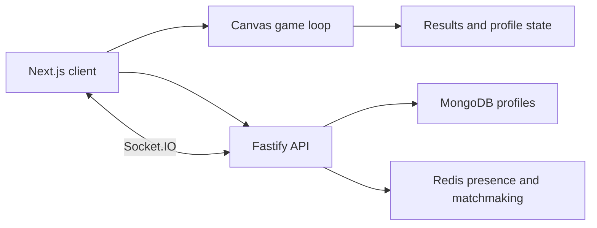

<div align="center">
  

  <p>
    
    
    
    <a href="LICENSE"></a>
  </p>
</div>

## 🎯 What it is

Zen Striker is a browser arcade shooter with a canvas-rendered game, mobile touch controls, player profiles, ranked matchmaking, and leaderboard/friend services. The game simulation and the account/matchmaking service live in separate frontend and backend folders.

<p align="center"></p>

## 🔁 Game and service flow



## ✨ Included systems

- Canvas rendering, game entities, physics, waves, audio, HUD, and pause/results screens.
- Touch-aware controls and game scaling for smaller screens.
- Fastify routes for authentication, users, friends, leaderboard, and matches.
- Socket.IO presence and matchmaking; MongoDB and Redis plugins.

## 🧰 Stack

| Part | Tools |
|---|---|
| Client | Next.js 15, React 19, TypeScript, Socket.IO client |
| API | Node.js, Fastify 5, TypeScript, Zod |
| Persistence | MongoDB/Mongoose, Redis |
| Auth | signed cookies/JWT flow in backend |
| Motion/game | Canvas renderer, custom physics and game loop |

## 🚀 Run locally

Start the API:

```bash
git clone https://github.com/ChristopherJoshy/ZenStriker.git
cd zen-striker/backend
npm ci
Copy-Item .env.example .env  # PowerShell; use cp on macOS/Linux
npm run dev
```

Start the web client in a second terminal:

```bash
cd zen-striker/frontend
npm install
npm run dev
```

Configure MongoDB, Redis, cookie/JWT secrets, and the frontend origin in local environment files. The frontend defaults to port 3000 and the API to port 3001.

## 🗂️ Layout

```text
frontend/app/       auth and game pages
frontend/components/ canvas, HUD, matchmaking and touch UI
frontend/lib/game/  entities, physics, rendering and waves
backend/src/        Fastify routes, plugins and Socket.IO
```

## 📄 License

MIT. See [`LICENSE`](LICENSE).